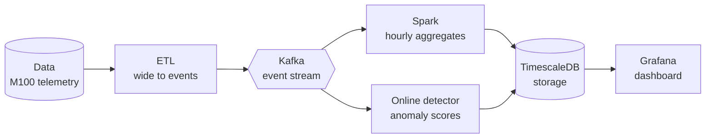
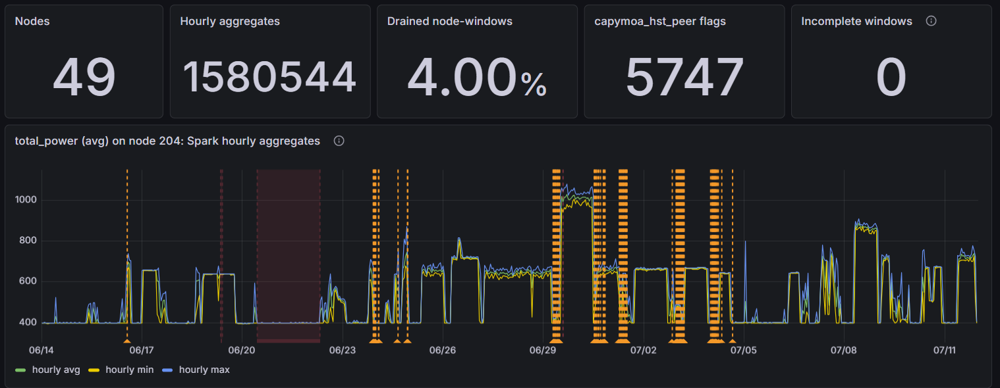
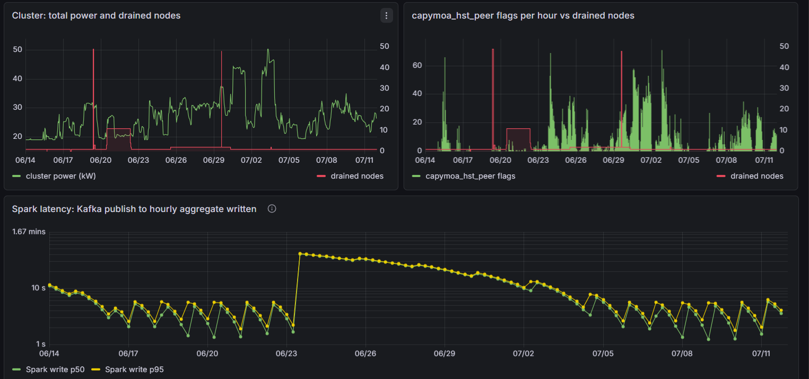

# HPC streaming telemetry

An end-to-end streaming pipeline that replays real supercomputer telemetry, from CINECA's
Marconi100 (980 nodes, 2020-2022), through Kafka. Two independent consumers read the same topic:

- **Spark Structured Streaming** that computes event-time windowed aggregates and upserts them into
  TimescaleDB.
- **An online detector service** that scores every node.



## Screenshots

**Node view.** Spark's hourly aggregates for one node. Red regions are periods when Nagios had the
node drained; orange markers are the selected detector's flags. Node, metric and detector are
selectable.



**Cluster view.** Total cluster power against the number of drained nodes, the detector's flags
per hour, and Spark's end-to-end latency.



## Data

[M100 dataset: time-aggregated data for anomaly detection](https://zenodo.org/records/7541722)
(Borghesi et al., _Scientific Data_ 2023, CC BY 4.0). One Parquet file per node with 15-minute
aggregates (avg / std / min / max of each IPMI metric).
The label comes from the Nagios alerting system.

| Nagios state | Description                                                                                                   |
| ------------ | ------------------------------------------------------------------------------------------------------------- |
| 0            | OK: the node can accept jobs                                                                                  |
| 2            | Critical: the node is drained or unavailable to the scheduler (the anomaly label used here)                   |
| 3            | Unknown: the check could not determine the state; rare, only during cluster-wide events, counted as anomalous |
| missing      | Unmonitored: no label, excluded from evaluation                                                               |

## Main results

- **Pipeline:** 74k messages/s, results in TimescaleDB 3.3 s after publish (median) with no lost or duplicated windows after killing and restarting Spark.
- **Unsupervised detection:** weak. The best detector reaches 0.59 per-node AUC.
- **Drain anticipation, 1 hour ahead:** **0.72 per-node AUC** in the stream, retrained every 4 weeks on delayed Nagios labels.

## Run it

```bash
conda env create -f environment.yml && conda activate hpc-stream

# download racks 10-12 from the Zenodo record above into data/raw/

python -m producer.etl                # ETL

docker compose up -d                   # Kafka, TimescaleDB, Spark, Grafana

python -m producer.replay_producer     # replay into Kafka

python -m streaming.online_detector    # online detector
```

Grafana is at <http://localhost:3001> (admin / admin to edit).

## Layout

```
producer/     ETL, replay producer, Avro schemas
streaming/    spark streaming job, online detector
sink/         TimescaleDB schema
dashboards/   provisioned Grafana datasource and dashboard
scripts/      evaluation scripts
docs/         docs and screenshots
report/       LaTeX report with the full methodology and results
tests/        unit tests
```
